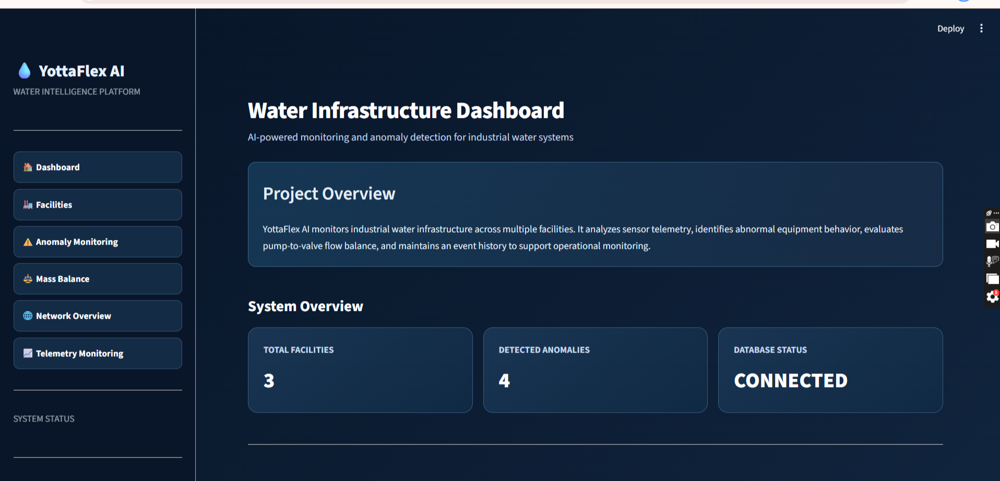
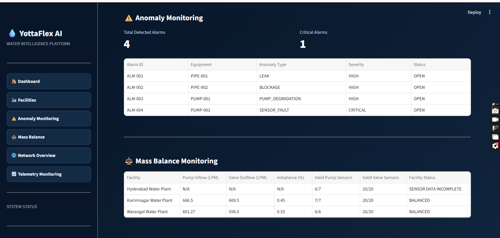

# YottaFlex AI – Water Infrastructure Monitoring System

AI-powered monitoring and anomaly detection for industrial water distribution networks.

## 1. Project Overview

YottaFlex AI is a Python-based prototype designed to monitor industrial water infrastructure across multiple facilities.

The system uses synthetic telemetry data, database-driven equipment information, anomaly detection rules, and mass balance calculations to identify potential operational issues.

It provides an interactive Streamlit dashboard to visualize network topology, monitor sensor readings, review detected anomalies, and evaluate facility health.

## 2. Key Features

- Multi-facility infrastructure monitoring
- Equipment and pipe network topology visualization
- Sensor telemetry monitoring and trend charts
- Rule-based anomaly detection
- Event history tracking
- Pump inflow and valve outflow mass balance analysis
- Sensor data quality validation
- Detection performance evaluation
- SQLite database integration
- Interactive Streamlit dashboard
- Pump performance curve reference data
- Pump curve integrity validation
- CSV, JSON, and SQL database exports
- Negative scenario testing
- SHA-256 export checksum generation

## 3. Facilities and Dataset

The prototype contains three synthetic facilities:

- Hyderabad Water Plant
- Karimnagar Water Plant
- Warangal Water Plant

The dataset includes:

| Entity | Count |
|---|---:|
| Facilities | 3 |
| Pumps | 20 |
| Tanks | 30 |
| Valves | 60 |
| Network nodes | 110 |
| Pipe connections | 110 |
| Sensors | 220 |
| Telemetry readings | 100,000 |
| Pump curve points | 60 |

## 4. Anomaly Detection

The system detects four types of anomalies:

| Anomaly | Detection Rule |
|---|---|
| Leak | Pipe pressure below 1.5 BAR |
| Blockage | Pipe pressure above 3.5 BAR |
| Pump Degradation | Pump flow below 50% of rated capacity |
| Sensor Fault | Sensor reports BAD quality |

The detection engine analyzes the latest 30 telemetry readings for each sensor.

## 5. Mass Balance Monitoring

The system compares total pump inflow with total valve outflow.

Imbalance is calculated as:

**Imbalance (%) = (Absolute difference between pump inflow and valve outflow / Valve outflow) × 100**

A deviation above 3% is classified as an imbalance.

The system also checks sensor quality and data completeness before evaluating mass balance.

## 6. Technology Stack

- Python
- SQLite
- Pandas
- NumPy
- NetworkX
- Plotly
- Streamlit

## 7. Data Generation and Reproducibility

The project uses synthetic infrastructure and telemetry data generated specifically for prototype evaluation.

- Fixed random seed: `20261022`
- Telemetry records: 100,000
- Facilities: 3
- Pumps: 20
- Pump curve reference points: 60

Refer to `docs/source_manifest.md` for data sources, generation scripts, and assumptions.

The project provides:

- 14 CSV table exports
- 14 JSON table exports
- SQL database export

The SQL database export is available at:

`exports/yottaflex_seed.sql`

SHA-256 export checksums are available in:

`docs/reproducibility_checksums.json`

**Note:** The checksum report records the current export file fingerprints. A complete two-run regeneration comparison has not yet been performed.

## 8. Project Structure

```text
YottaFlex-AI/
│
├── database/
│   ├── schema.sql
│   └── yottaflex.db
│
├── data/
│
├── docs/
│   ├── AI_PROMPTS.md
│   ├── assumptions_and_limitations.md
│   ├── data_dictionary.md
│   ├── reproducibility_checksums.json
│   ├── source_manifest.md
│   └── validation_summary.md
│
├── exports/
│   ├── CSV table exports
│   ├── JSON table exports
│   └── yottaflex_seed.sql
│
├── screenshots/
│   ├── dashboard-overview.png
│   ├── anomaly-monitoring.png
│   └── mass-balance.png
│
├── src/
│   ├── db.py
│   ├── seed_data.py
│   ├── generate_telemetry.py
│   ├── inject_anomalies.py
│   ├── create_pump_curves.py
│   ├── detection_engine.py
│   ├── evaluate_detection.py
│   ├── validate_telemetry.py
│   ├── validate_anomalies.py
│   ├── test_negative_scenarios.py
│   ├── export_data.py
│   ├── verify_reproducibility.py
│   ├── simulate_operating_mode.py
│   ├── mass_balance.py
│   ├── check_flow_balance.py
│   ├── calibrate_valve_flow.py
│   └── dashboard.py
│
├── main.py
├── requirements.txt
├── .gitignore
└── README.md
```

## 9. Installation and Setup

### Prerequisites

- Python 3.10 or higher
- pip
- Git

### Step 1: Clone the repository

```bash
git clone https://github.com/MUDRAKOLAMANISH/YottaFlex-AI.git
cd YottaFlex-AI
```

### Step 2: Create a virtual environment

```bash
python -m venv .venv
```

Activate it on Windows:

```powershell
.venv\Scripts\activate
```

### Step 3: Install dependencies

```bash
pip install -r requirements.txt
```

### Step 4: Launch the dashboard

```bash
streamlit run src/dashboard.py
```

Open the local URL displayed in the terminal.

The repository includes a pre-populated SQLite database at `database/yottaflex.db`.

## 10. Validation Results

The synthetic test dataset produced the following anomaly detection results:

| Metric | Result |
|---|---:|
| True Positives | 4 |
| False Positives | 0 |
| False Negatives | 0 |
| True Negatives | 216 |
| Accuracy | 100% |
| Precision | 100% |
| Recall | 100% |
| F1 Score | 100% |

These metrics represent performance on the controlled synthetic test dataset and do not establish real-world detection accuracy.

### Additional Validation

| Validation | Result |
|---|---|
| Telemetry integrity | Passed |
| Pump curve integrity | Passed |
| Anomaly validation | Passed |
| SQL export import test | Passed |
| Negative scenario testing | 5/5 Passed |
| Fresh schema creation | Passed |

Detailed results are documented in `docs/validation_summary.md`.

## 11. Mass Balance Results

| Facility | Imbalance | Result |
|---|---:|---|
| Hyderabad | N/A | Sensor Data Incomplete |
| Karimnagar | 0.45% | Balanced |
| Warangal | 0.55% | Balanced |

Hyderabad's mass balance is not evaluated because one pump sensor has invalid quality data.

## 12. Dashboard Modules

1. System Overview
2. Facility Overview
3. Network Topology
4. Telemetry Monitoring
5. Anomaly Monitoring
6. Mass Balance Monitoring
7. Facility Health Status
8. Event History

## 13. Assumptions and Limitations

- The dataset is synthetic and generated for prototype evaluation.
- Network topology represents a simplified network structure.
- Anomaly detection uses predefined threshold-based rules.
- Pump curve points are synthetic reference values, not manufacturer-certified curves.
- Operating-mode flow estimates use a simplified linear capacity assumption.
- Mass balance is an operational comparison, not a complete hydraulic simulation.
- Sensor coverage and data quality affect the reliability of mass balance results.
- The prototype has not been validated against real industrial water infrastructure.
- A complete two-run reproducibility comparison has not yet been performed.

## 14. Future Enhancements

- Real-time sensor integration
- Advanced anomaly detection using machine learning
- Predictive maintenance
- More detailed hydraulic simulation
- Automated alerts and notifications
- Historical analytics and reporting

## 15. Author

**Manish Mudrakola**

B.Tech – Computer Science and Information Technology

GitHub: [MUDRAKOLAMANISH](https://github.com/MUDRAKOLAMANISH)

Repository: [YottaFlex AI](https://github.com/MUDRAKOLAMANISH/YottaFlex-AI)

---

*YottaFlex AI – Intelligent Industrial Water Infrastructure Monitoring*

## 📸 Dashboard Screenshots

### 1. Dashboard Overview



### 2. Anomaly Monitoring



### 3. Mass Balance Monitoring


